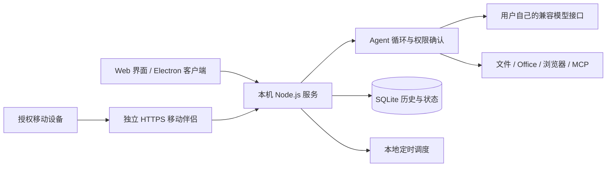

# BuddyLab · 本地 AI 工作台

**仅用于学习、个人实验与非商业研究。非腾讯或 WorkBuddy 官方项目，不提供原版帐号、商业服务、授权绕过或付费功能破解。** 使用前请阅读 [免责声明](DISCLAIMER.md)、[项目许可](LICENSE) 和 [第三方资源说明](THIRD_PARTY_NOTICES.md)。

BuddyLab 是一个能连接真实模型与工具的本地 AI 工作台，用于学习桌面 Agent 的执行循环、工具调用、持久化会话、权限确认和交互设计。项目参考 WorkBuddy 的可见使用流程与公开资料，自主实现本地运行能力，使用自己的 OpenAI 兼容接口。

它没有固定演示回复。模型、插件、远程通道未配置时会显示实际状态，不把按钮、静态卡片或样例数据冒充已经执行的任务。

公开版保留可运行的核心代码、测试、中文文档和具有明确许可证的第三方组件。原版参考素材的**出处与校验清单**随仓库提供；没有明确再分发许可的原图、字体、商业提示词和提取代码未直接分发。有权使用的本机资源可通过 [本机导入说明](reference/README.md) 恢复，原有本机研究版本不受影响。

## 能做什么

| 能力 | 当前实现 |
|---|---|
| 模型工作台 | OpenAI 兼容 Chat Completions；真实 SSE/JSON 回复、工具调用、模型列表与连接测试 |
| 执行模式 | Agent、Plan、Ask、Quick；日常办公、代码开发、设计创意三类工作入口 |
| 交互式问答 | `ask_user` 暂停当前运行；选项与自由文本回答后继续同一轮，浏览器刷新可恢复问题 |
| 思考内容 | 仅展示模型主动返回的 `reasoning_content`；不伪造、不要求模型暴露未提供的推理 |
| 文件与办公产物 | 工作空间文件、附件、文本编辑与检查点；Word、Excel、PDF、PowerPoint 生成和读取 |
| 浏览器与工作面板 | 隔离 Chromium 页面、正文和 DOM、真实表单操作、截图、多标签、文件查看与命令输出 |
| 历史与任务 | SQLite 持久化、搜索、置顶、归档、回收站、队列、子任务与专家协作 |
| 专家与技能 | 收录具有 MIT 许可的 Agency 中文角色；支持自定义角色、`SKILL.md`、技能 ZIP 和本机插件导入 |
| MCP | stdio / Streamable HTTP 连接、工具发现与调用、启停和秘密环境变量引用 |
| 定时任务 | 单次、间隔、每天、每周、双周、每月、每年；启停、立即运行与实际结果 |
| 记忆 | 用户 / 工作空间记忆；SOUL、IDENTITY、USER、WORKING 档案与版本冲突保护 |
| 移动伴侣 | 自有移动 Web、一次性配对、电脑批准、可撤销设备授权、只读远程任务与消息中心 |
| 桌面客户端 | Electron；Mac ARM / Intel、Windows x64 构建配置；原生设置窗口、托盘和保持唤醒 |

## 快速开始

需要 **Node.js 22.13+**，建议使用 Node.js 24 LTS。依赖与浏览器首次安装需要网络。

```bash
git clone https://github.com/WilliamLIiii/buddy-lab.git
cd buddy-lab
npm ci
npm run setup:browser
npm start
```

打开 [本地工作台](http://127.0.0.1:47831/)。默认只监听 `127.0.0.1`，不是公共网站或多用户服务器。

在左下角**设置 → 模型**中填写自己的兼容服务地址、模型名称和 API Key，然后测试连接并保存。基础地址应包含服务所需的 `/v1` 等前缀，应用会追加 `/chat/completions`；需要模型实际支持 function tools，才能执行工具任务。连接测试本身不保证工具能力。

本机兼容服务可以不填 Key；远端服务通常需要 Key。不要把 Key 放进聊天、源代码或 Git。应用优先使用自己的系统安全存储；无法安全持久化时明确退为进程内存。

也可通过 `BUDDYLAB_BASE_URL`、`BUDDYLAB_MODEL`、`BUDDYLAB_API_KEY` 注入配置。私密环境配置不得提交到仓库。`BUDDYLAB_PORT` 可以修改默认端口。

## 桌面运行与构建

```bash
# 开发模式
npm run desktop:dev

# 按目标构建；首次会下载固定版本的运行时与浏览器
npm run desktop:build -- --target=mac-arm64
npm run desktop:build -- --target=mac-x64
npm run desktop:build -- --target=win-x64
```

输出位于 `output/desktop/`，不进入 Git。默认不会把本机原版参考素材打入分发包。正式公开分发前仍需要核对签名、平台实机运行和全部第三方许可；本仓库不附带私有本机安装包。

Mac ARM 的本地研究构建经过实际运行验证；Windows / Intel 配置存在，但**不能把跨平台构建成功视为完整实机验收**。GitHub Actions 提供测试和手动 Windows 构建流程。

## 权限与数据

- **默认权限**：写文件、命令、MCP 和网页写操作需要确认。只读模式不能通过子任务提升权限。
- **完全访问**：默认关闭，只对明确声明的本地工具免逐次确认。MCP、网页写操作和未知外部工具仍确认。
- 文件工具限定工作空间，拒绝越界和敏感路径；**命令与第三方 MCP 进程没有操作系统级沙箱**，使用当前账户权限。
- 模型会收到用户输入、所选上下文及工具读取的资料，请自行核对服务供应商、费用和隐私要求。
- `.data/`、`workspaces/`、`.env`、日志、构建产物与本机参考素材均不提交。关闭或重启服务会中断未完成运行，不自动重放旧审批。
- 移动访问默认关闭；局域网使用 HTTPS、短期一次性配对与电脑批准，不提供免认证公网入口。保持唤醒不修改锁屏策略。

## 架构



前端采用原生 JavaScript、CSS、Markdown 渲染与内容净化；后端通过 Node.js 内置 SQLite 保存实际事件与状态。模型回复、工具结果、审批、提问、执行阶段和产物分别记录，界面由真实事件更新。

## 项目目录

```text
src/                 本地服务、Agent、工具、存储、权限与移动伴侣
web/                 前端和公开版自主素材
desktop/             Electron 主进程、受限 IPC 与预加载
resources/prompts/   自主实现的分层运行指令
resources/agency-agents-zh/  MIT 角色目录与原许可证
resources/vendor/    保留许可与来源的必要组件
scripts/             启动、构建、验证与本机参考资源导入
test/                隔离数据和回环接口的自动化检查
docs/                中文介绍、架构与能力契约
reference/           原版参考素材清单和导入说明；不含资源字节
```

## 验证

```bash
npm test
```

测试使用隔离工作区、临时数据和本机模型 / MCP fixture，不依赖个人帐号，也不向商业模型自动发送请求。测试浏览器需要完成 `npm run setup:browser`。

本地研究版本 0.4.4 的完整回归为 212 项，其中 211 通过、1 项 Windows 平台跳过；公开版另经215项检查，214通过、1项Windows平台跳过；后续结果以本仓库实际测试与CI为准。历史本机截图和数据库不随仓库上传。

## 已知限制

1. 不是原版后端的完整等价实现；没有继承 WorkBuddy 帐号、积分、云资料库或云市场授权。
2. 微信小程序、微信 / QQ / 飞书 / 钉钉等接收通道尚未接入；移动 Web 是本项目自己的伴侣服务。企微仅有明确确认后的出站通知适配器。
3. 工作面板终端支持单次非交互命令、输出、取消和退出码，当前不支持 PTY 交互终端。
4. HTML 预览有权限和网络隔离；不是完整 Office 在线编辑器。扫描 PDF 暂不自动 OCR。
5. 语音能力依赖运行环境；图像、视频和发布能力需要自己的真实连接器与授权。
6. 原版参考资源需要使用者自行确认使用权；本机导入不能理解为公开分发许可。

## 参考与致谢

- [agency-agents-zh](https://github.com/jnMetaCode/agency-agents-zh)：中文角色目录，保留 MIT 许可、作者与固定版本来源。
- [WorkBuddyGuide](https://github.com/AlephAITech/WorkBuddyGuide)：公开使用流程参考。
- [workbuddy-experts](https://github.com/vbarter/workbuddy-experts)：能力和架构研究参考；未将第三方原版插件或提取代码作为本项目公开源码重新分发。
- [REA](https://github.com/morluto/rea)：辅助分析用户有权访问的本地安装包与可见界面。静态分析与真实运行验证分别记录。

更多说明：[项目介绍](docs/项目介绍.md) · [执行契约](docs/execution-contract.md) · [工作面板](docs/side-panel-contract.md) · [本机参考素材](reference/README.md)。
